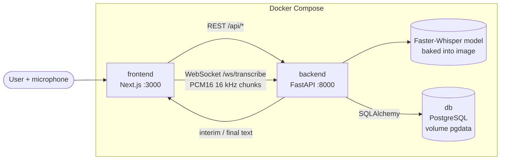
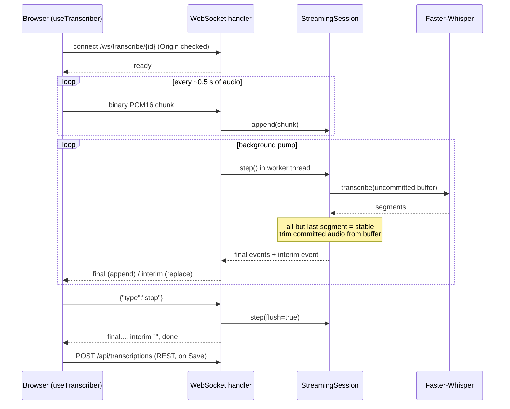
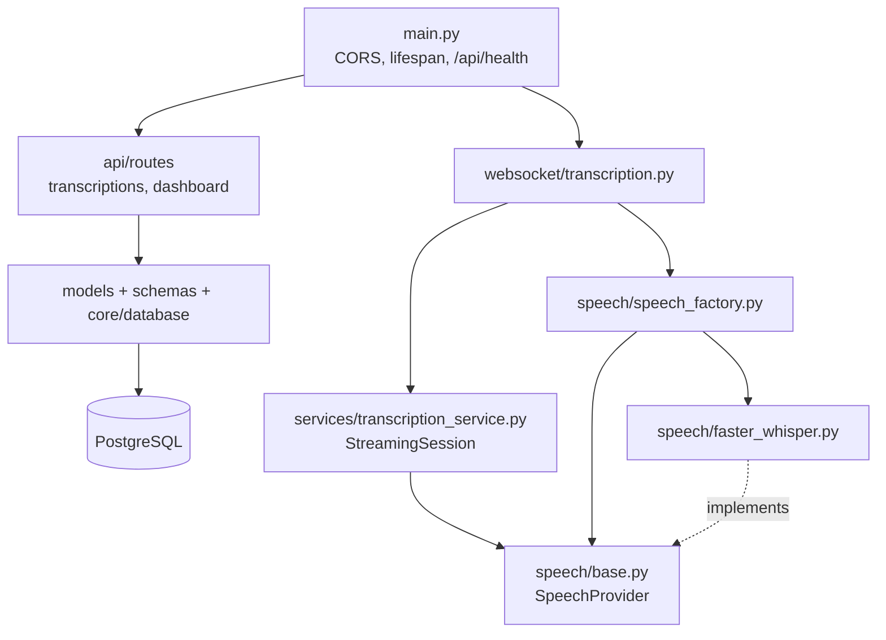
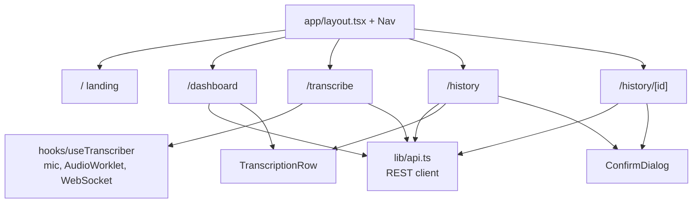
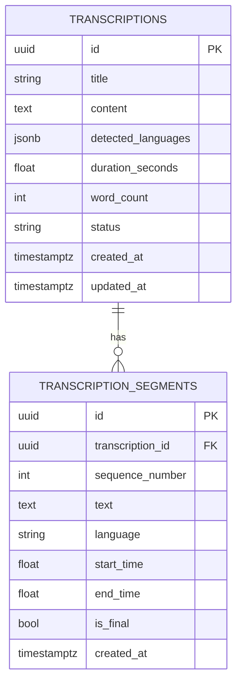

# Architecture

## System overview

The browser talks to both the frontend (page assets) and the backend (REST and WebSocket) directly. The frontend container only serves the UI.

## Live transcription sequence

## Backend components

Adding another speech provider means implementing `SpeechProvider` and adding one branch in the factory.

## Frontend components

## Data model

## Container startup order

`db` (healthy) then `backend` (runs migrations, loads the model, healthy) then `frontend`.
