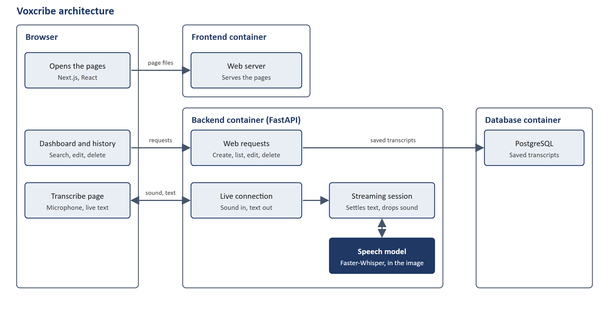
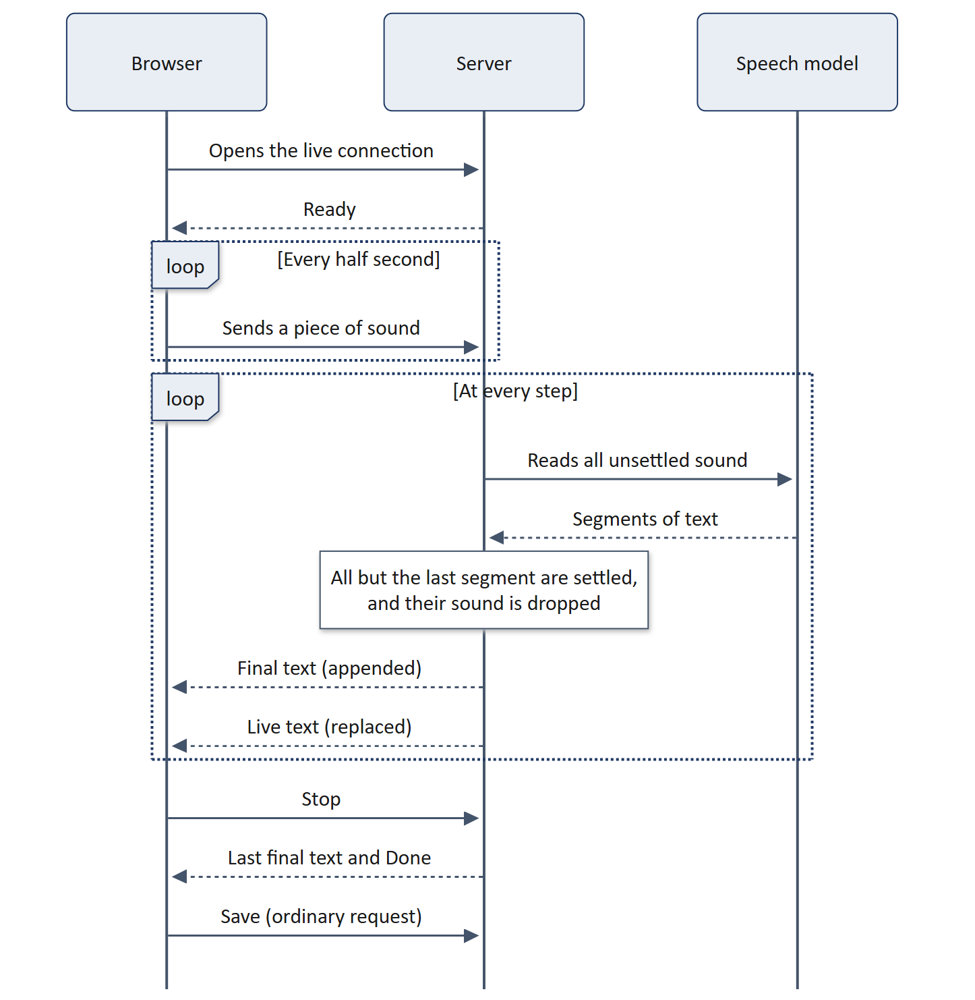

# Architecture

## System overview

The browser loads the pages from the frontend container. It then talks to the backend container directly: ordinary requests for saved transcripts, and a live connection that carries sound in and text out. The backend runs the speech model inside the same container and stores saved transcripts in PostgreSQL.

## Live transcription flow

Sound is sent in pieces of about half a second. At every step the server reads all unsettled sound. All segments except the last are settled and sent as final text, and their sound is dropped. The last segment is sent as live text and read again at the next step.

## Files

| File | Purpose |
|---|---|
| architecture/architecture.svg, architecture.png | System overview (hand drawn source and exported image) |
| architecture/live-transcription.mmd, live-transcription.png | Live transcription flow (Mermaid source and exported image) |

For the full explanation see the [technical documentation](Voxcribe-Technical-Documentation.docx).
