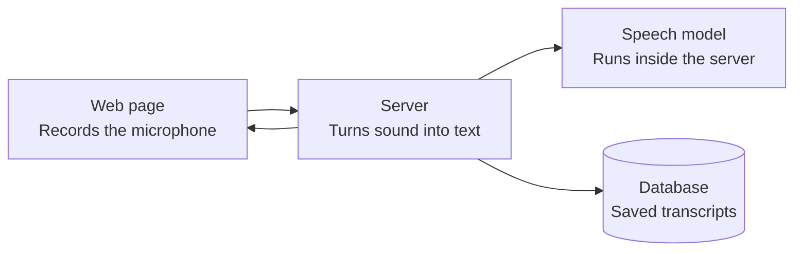

# Overview

Voxcribe lets a person speak into a microphone and read the words on screen a moment later. It keeps the words in the language that was spoken, so a sentence that mixes Hindi and English stays mixed. When the person is happy with the text, it is saved, and it can be searched, edited, exported or deleted later.

The application has three parts that run together: a web page that the person uses, a server that turns audio into text, and a database that keeps the saved text. All three start with one command, and the speech model is built into the server package, so no outside service or key is needed.

# How the parts fit together

The web page records the microphone and sends the sound to the server in small pieces. The server turns the sound into text and sends the text back at once. When the person presses Save, the web page sends the finished text to the server, which stores it in the database.

Caption: Sound goes to the server, text comes back, and saved transcripts go to the database.

The web page also talks to the server for ordinary tasks such as listing, editing and deleting saved transcripts. The next sections follow the live path in detail.

# Recording in the browser

The web page first asks the browser for permission to use the microphone. If the person refuses, or no microphone exists, the page shows a clear message and nothing is sent.

Once permission is given, the page captures the sound on a separate audio thread so that the screen stays smooth. It reduces the sound to a lower quality that is enough for speech, collects about half a second of it, and sends that piece to the server. The page never waits for the person to stop speaking.

The page offers four controls. Pausing stops the sending of sound and asks the server to settle the text so far. Resuming starts sending again. Stopping sends the last piece, waits for the server to finish, and then releases the microphone and the connection. If the connection drops, the text already on screen is kept and the person can start again.

| Setting | Value | Reason |
|---|---|---|
| Sample rate sent to the server | 16,000 per second | The rate the speech model expects |
| Sound format | 16-bit, one channel | Small and simple to check |
| Size of each piece | About 0.5 seconds | Short enough to feel live |
| Wait for the server after Stop | Up to 20 seconds | The last text needs time to be produced |

# Turning sound into text

Speech models such as Whisper read a stretch of audio and return text for the whole stretch. They do not produce words one at a time. Voxcribe therefore works in small steps and is honest about what it is: it is chunk based incremental transcription, not word by word streaming.

The server keeps the sound it has received but not yet settled. Every half second or so it asks the model to read all of that sound and return the sentences it hears. The model divides its answer into segments. Every segment except the last is treated as settled, because later sound followed it and the model has seen enough context. The last segment may still change, so it is shown as live text.

Settled segments are sent to the page as final text and the sound behind them is removed from the server's memory. The page appends final text and never repeats it. The live text is replaced at every step.

1. The server collects the newest sound.
2. The model reads all the unsettled sound.
3. All segments except the last are sent as final text, and their sound is dropped.
4. The last segment is sent as live text and read again at the next step, with more sound behind it.
5. If the unsettled sound grows past 25 seconds with only one segment, that segment is settled anyway so that the server's memory does not keep growing.
6. When the person pauses or stops, everything that remains is settled.

If the model is slower than the speaker, the server does not fall behind. It simply reads the newest sound at the next step. On a normal computer processor, the delay between speaking and seeing the words is about one to three seconds.

# Silence and short pieces

The model is told to ignore parts of the sound that contain no speech. When the last piece of a recording is only silence, this filter removes all of it, and the model library version in use then fails while guessing the language of nothing. The server treats that failure as an empty result, so stopping a recording after a pause no longer ends in an error.

# Languages

The page does not ask for a language. The model decides the language of each stretch of sound by itself. Its task is set to transcribe, so speech is written in the language spoken and is never translated.

The model reports one language for each stretch. A sentence that starts in Hindi and continues in English is usually written in a mixed form, but how well that works depends on the size of the model. When the model reports a language other than English and the text still contains English words, the server adds English to the list of languages for that segment. The list is shown as small labels on the page and is saved with the transcript.

| Model size | Speed on a processor | Accuracy for mixed languages |
|---|---|---|
| Small (the default) | Moderate | Acceptable for everyday speech |
| Medium | Slower | Better |
| Large | Slowest | Best |

# Replaceable speech engine

The server does not depend on one speech model. It talks to a small set of operations that any engine can provide: turn audio into text, name the language of some audio, and shut down. The first engine is Faster-Whisper. A new engine is added by writing one class that provides those operations and adding it to a short list in the factory file. A setting then chooses which engine runs.

If the chosen engine cannot start, the server tells the page so with a clear error message. It never returns made up text.

# Stored data

Saved transcripts live in a PostgreSQL database. Each transcript holds a title, the full text, the list of languages, the length of the recording, the number of words, a status and two dates. A second table is prepared for the individual segments with their start and end times. The current page saves only the full text, so the segment table fills only when another program supplies segments through the interface.

| Table | Main contents | Notes |
|---|---|---|
| transcriptions | Title, content, detected languages, duration, word count, status, created and updated dates | Indexed by creation date and by language |
| transcription_segments | Text, language, start and end time, whether final | Removed automatically with its transcript |

Changes to the tables are made through numbered migration scripts. The server runs them every time it starts, so a new database is prepared without manual steps.

# Saving, searching and editing

The history page lists transcripts a page at a time. It can search the title and text, filter by language and by date, and sort by newest or oldest. Typing in the search box waits a third of a second before it asks the server, and an older answer that arrives late is ignored. Every deletion asks for confirmation first.

A new transcript without a title receives one made from its first six words. Editing the text updates the word count. The page that shows a single transcript can also copy the text, download it as a text file, or open a print view that can be saved as a PDF. The print view is used because the browser draws Hindi and Tamil text correctly there.

# Running the application

One command builds and starts the database, the server and the web page. The database starts first, the server starts when the database is ready, and the web page starts when the server reports that its model is loaded. The speech model is downloaded while the server package is built, so the running server needs no internet access.

The table below lists the settings. They are kept in a file named .env that is not stored in the code repository. A template file shows every setting.

| Setting | Default | What it does |
|---|---|---|
| POSTGRES_USER, POSTGRES_PASSWORD, POSTGRES_DB | voxcribe, none, voxcribe | Database login. The password must be set |
| WHISPER_MODEL | small | Size of the speech model. Changing it needs a new server build |
| WHISPER_DEVICE, WHISPER_COMPUTE_TYPE | cpu, int8 | Where and how the model runs |
| STT_PROVIDER | faster_whisper | Which speech engine runs |
| CORS_ORIGINS | http://localhost:3000 | Web addresses allowed to use the server |
| NEXT_PUBLIC_API_URL | http://localhost:8000 | Address of the server as the browser sees it. Changing it needs a new web page build |
| FRONTEND_PORT | 3000 | Port on the computer where the web page appears |

# Security and limits

The application has no sign-in. Anyone who can reach the server can read, change and delete every transcript, so it is meant for a single user on a trusted computer. It must not be placed on the public internet as it is.

The server accepts connections only from the web addresses in its allowed list, and checks the origin of every live connection. Passwords and other secrets come from the environment and are never written into the code. The server runs as an ordinary user inside its package. Search text is escaped, and every database query uses bound values.

| Limit | Value |
|---|---|
| Size of one sound piece | 320 kilobytes, about 10 seconds |
| Total sound in one session | 3,600 seconds |
| Length of one transcript | 1,000,000 characters |
| Results per page | At most 100 |
| Live text window before a forced settle | 25 seconds |

# What can go wrong

| Situation | What the person sees | What happens |
|---|---|---|
| Microphone permission refused | A message asking to allow access | Nothing is recorded or sent |
| Server not reachable | A message that the server cannot be reached | Recording does not start |
| Connection drops while recording | A message that the connection was lost | Text so far is kept, the person can start again |
| Speech model fails to load or crashes | A message from the server | The live session ends, saved data is untouched |
| Sound piece is empty or too large | A message from the server | The piece is ignored and the session continues |
| Save fails | A message under the buttons | Text stays on screen so it can be saved again |

# How it was tested

The part that settles text and removes sound is covered by three automated tests that use a stand-in speech engine. They check that settled text is sent once, that stopping settles everything, and that bad sound pieces are refused. The server package and the web page package were built and started with Docker, the health check was read, and a transcript was created, listed and deleted through the interface. Every page of the web application returned a successful answer.

Live speech was tried by the owner in a browser. There is no automated test that speaks into a microphone, and no automated test of the interface or of the full set of server endpoints.

# Current limits

The model names one language for each stretch of sound, so quick switches inside one sentence depend on the model size. Text typed by hand while recording stays, but new final text is always added at the end. The recording length that is saved comes from the timer on the page. The Docker setup uses the processor only. A graphics card needs a different base image that is not included. Settings, profile and sign-in pages, a second speech engine and keyboard shortcuts are not part of this version.

# Glossary

| Term | Meaning |
|---|---|
| Whisper | A speech recognition model that reads audio and writes text in many languages |
| Faster-Whisper | A faster way of running Whisper, used as the first speech engine |
| WebSocket | A connection that stays open so the page and the server can send data to each other at any time |
| Final text | Text that the server regards as settled and will not change |
| Live text | The newest text, which may still change at the next step |
| Segment | One sentence or phrase returned by the model, with a start and an end time |
| Migration | A numbered script that changes the database tables |
| Docker Compose | A tool that starts several connected programs from one description |
| PostgreSQL | The database that stores saved transcripts |
